# System Flows — Mermaid Diagrams

---

## 1. Variable Data Flow — UI ↔ Action (Release Coupon Campaign)

Mỗi widget `outputVarId` kết nối với action parameter `varId` qua Variable. Biến truyền xuyên suốt các Step trong Execution Context.

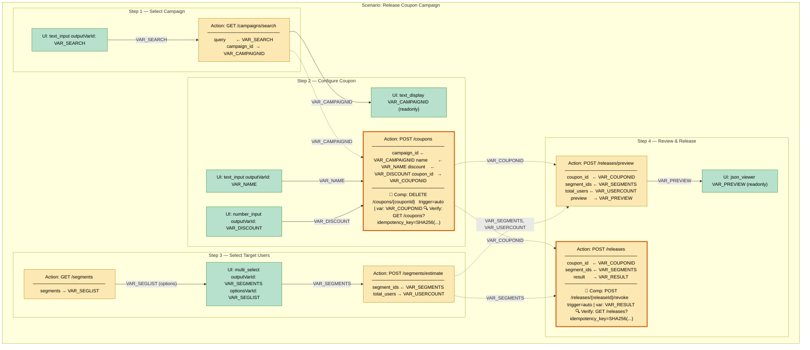

<!-- ```mermaid
flowchart TD
    classDef uiNode     fill:#b7e1cd,stroke:#2d8a2d,color:#000
    classDef actNode    fill:#fce8b2,stroke:#b8860b,color:#000
    classDef actNodeKey fill:#fce8b2,stroke:#cc5500,stroke-width:3px,color:#000

    subgraph SCEN["Scenario: Release Coupon Campaign"]
        subgraph S1["Step 1 — Select Campaign"]
            direction LR
            UI1["UI: text_input\noutputVarId: VAR_SEARCH"]:::uiNode
            ACT1["Action: GET /campaigns/search\n──────────────────────\nquery        ← VAR_SEARCH\ncampaign_id  → VAR_CAMPAIGNID"]:::actNode
        end

        subgraph S2["Step 2 — Configure Coupon"]
            direction LR
            UI2a["UI: text_display\nVAR_CAMPAIGNID (readonly)"]:::uiNode
            UI2b["UI: text_input\noutputVarId: VAR_NAME"]:::uiNode
            UI2c["UI: number_input\noutputVarId: VAR_DISCOUNT"]:::uiNode
            ACT2["Action: POST /coupons\n──────────────────────\ncampaign_id ← VAR_CAMPAIGNID\nname        ← VAR_NAME\ndiscount    ← VAR_DISCOUNT\ncoupon_id   → VAR_COUPONID\n──────────────────────\n🔄 Comp: DELETE /coupons/{couponId}\n   trigger=auto | var: VAR_COUPONID\n🔍 Verify: GET /coupons?idempotency_key=SHA256(...)"]:::actNodeKey
        end

        subgraph S3["Step 3 — Select Target Users"]
            direction LR
            UI3["UI: multi_select\noutputVarId: VAR_SEGMENTS\noptionsVarId: VAR_SEGLIST"]:::uiNode
            ACT3a["Action: GET /segments\n──────────────────────\nsegments → VAR_SEGLIST"]:::actNode
            ACT3b["Action: POST /segments/estimate\n──────────────────────\nsegment_ids ← VAR_SEGMENTS\ntotal_users → VAR_USERCOUNT"]:::actNode
        end

        subgraph S4["Step 4 — Review & Release"]
            direction LR
            UI4["UI: json_viewer\nVAR_PREVIEW (readonly)"]:::uiNode
            ACT4a["Action: POST /releases/preview\n──────────────────────\ncoupon_id   ← VAR_COUPONID\nsegment_ids ← VAR_SEGMENTS\ntotal_users ← VAR_USERCOUNT\npreview     → VAR_PREVIEW"]:::actNode
            ACT4b["Action: POST /releases\n──────────────────────\ncoupon_id   ← VAR_COUPONID\nsegment_ids ← VAR_SEGMENTS\nresult      → VAR_RESULT\n──────────────────────\n🔄 Comp: POST /releases/{releaseId}/revoke\n   trigger=auto | var: VAR_RESULT\n🔍 Verify: GET /releases?idempotency_key=SHA256(...)"]:::actNodeKey
        end
    end

    UI1   -->|"VAR_SEARCH"| ACT1
    ACT1  -->|"VAR_CAMPAIGNID"| UI2a
    ACT1  -.->|"VAR_CAMPAIGNID"| ACT2
    UI2b  -->|"VAR_NAME"| ACT2
    UI2c  -->|"VAR_DISCOUNT"| ACT2
    ACT3a -->|"VAR_SEGLIST (options)"| UI3
    UI3   -->|"VAR_SEGMENTS"| ACT3b
    ACT2  -.->|"VAR_COUPONID"| ACT4a
    ACT2  -.->|"VAR_COUPONID"| ACT4b
    ACT3b -.->|"VAR_SEGMENTS, VAR_USERCOUNT"| ACT4a
    ACT3b -.->|"VAR_SEGMENTS"| ACT4b
    ACT4a -->|"VAR_PREVIEW"| UI4
``` -->

> Mũi tên `-->` = kết nối trong cùng Step. Mũi tên `-.->` = variable truyền qua Execution Context từ Step trước.
> Node viền cam đậm (`actNodeKey`) = action có **Compensation** + **Verification** block — quan trọng với Saga và Reconciler.

---

## 1b. Rollback Flow — Step 4 Fails (Saga Compensation)

Khi `actdef_confirm_release` (Step 4) FAILED, Saga Manager chạy compensation ngược:
- Step 4: FAILED → skip (chưa complete, không cần compensate)
- Step 3: `actdef_estimate_targets` trigger=**none** (read-only) → skip
- Step 2: `actdef_create_coupon` trigger=**auto** → **RUN** — dùng `VAR_COUPONID` từ `context_snapshot`
- Step 1: `actdef_search_campaigns` trigger=**none** (read-only) → skip

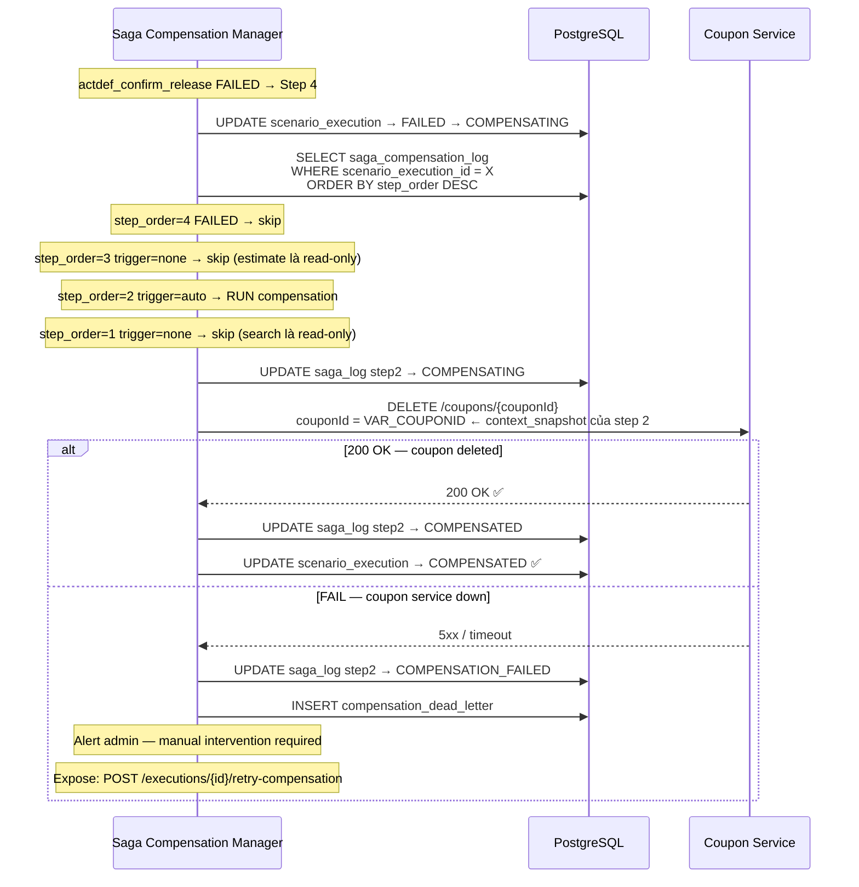

---

## 1c. Reconciliation Flow — POST /coupons Times Out

Khi `actdef_create_coupon` (Step 2) TIMEOUT — Console không biết coupon đã được tạo chưa.
Reconciler dùng `verification` block để check state thực tế trên Coupon Service.

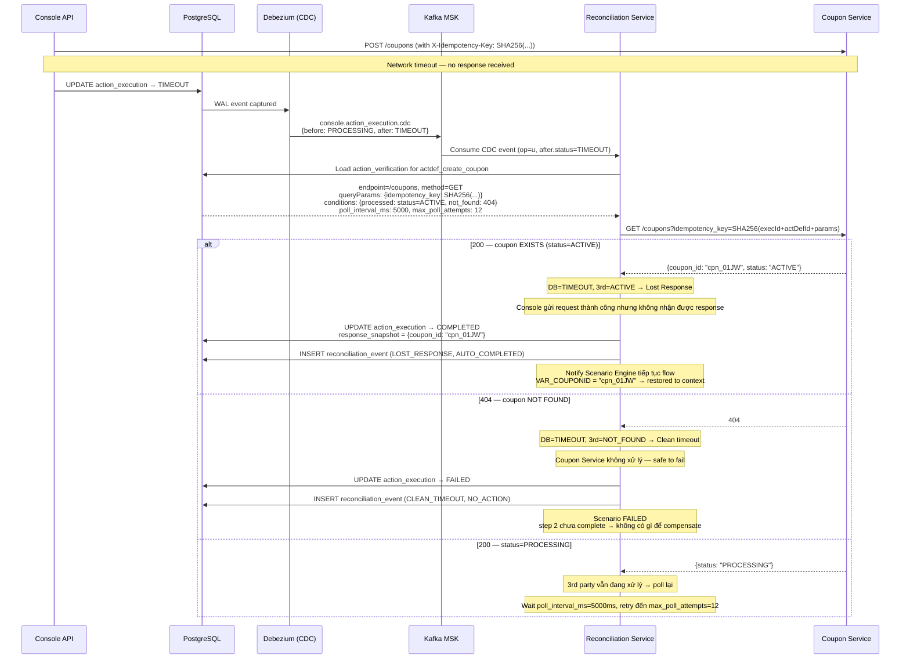

---

## 1d. Scenario End-to-End — Happy Path + Failure Paths

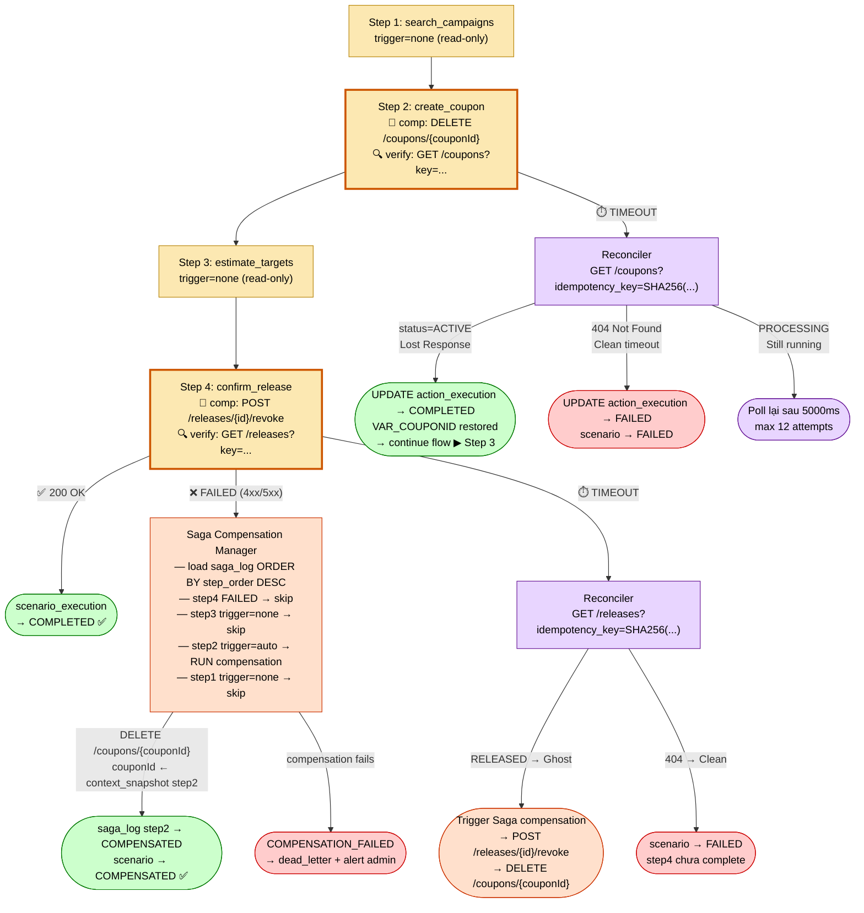

---

## 2. Execution Engine — Button Click Flow

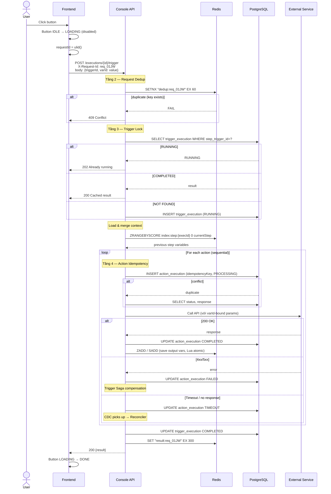

---

## 3. State Machines

### 3a. action_execution

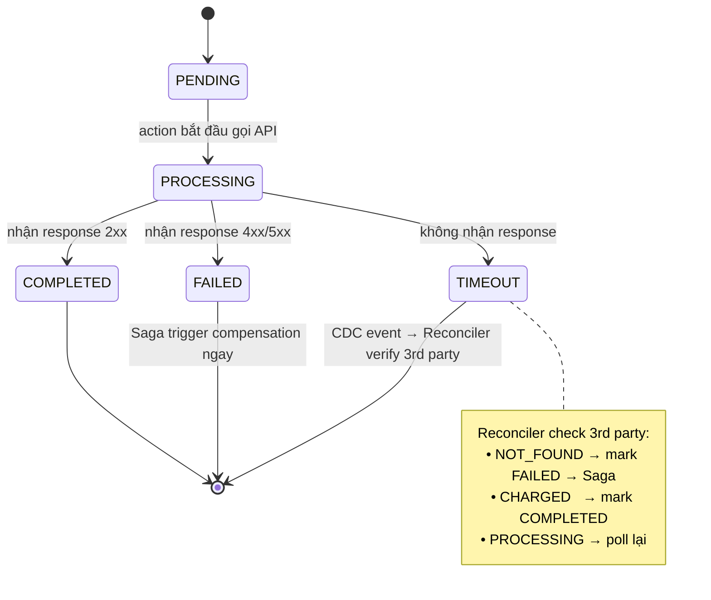

### 3b. scenario_execution

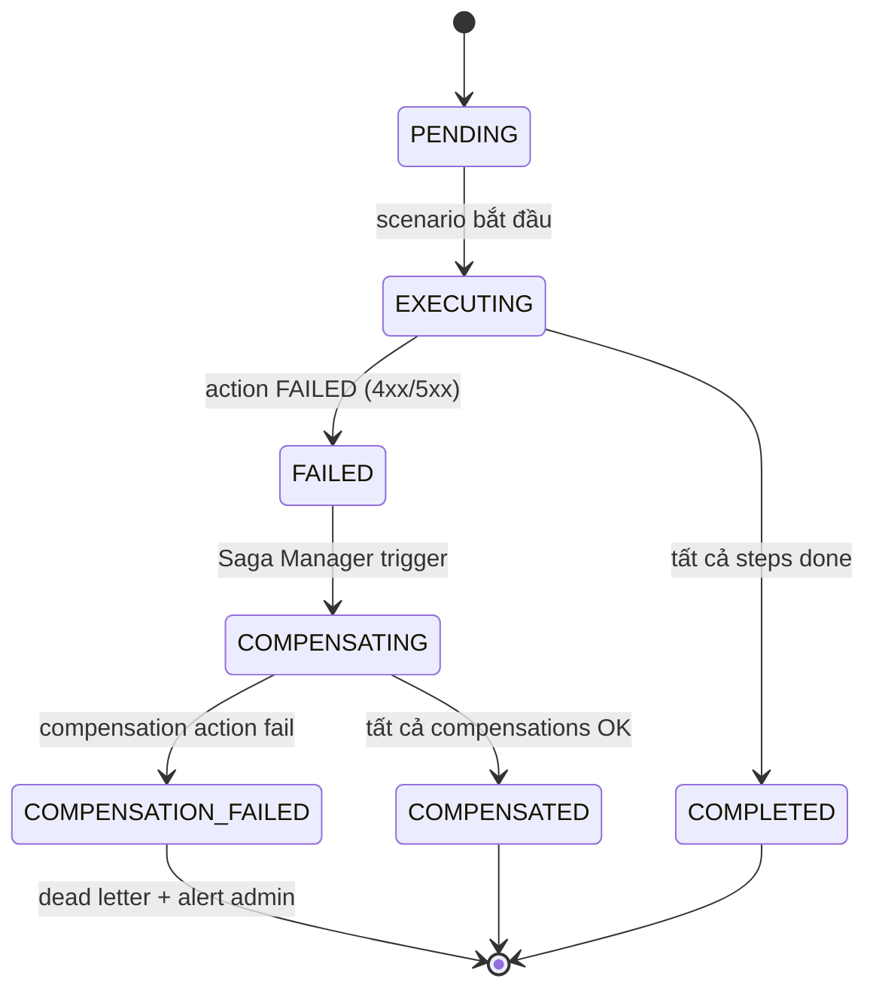

---

## 4. Idempotency — 4 Tầng Chống Duplicate

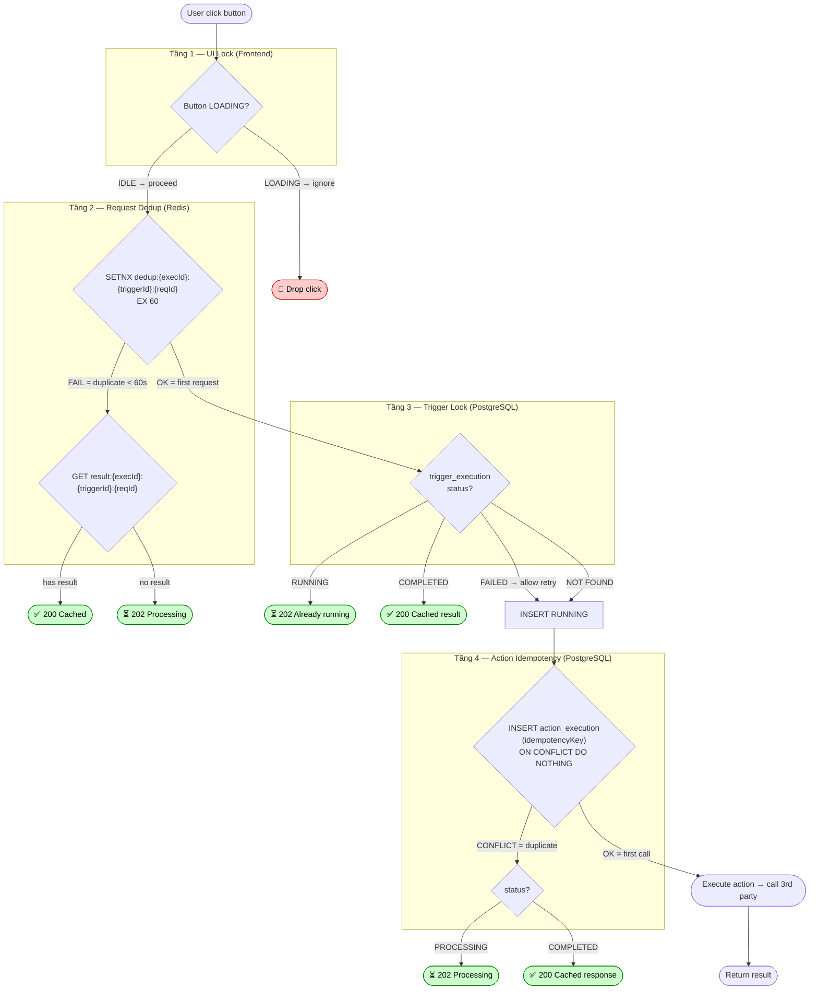

---

## 5. Two-Phase Commit (DB First)

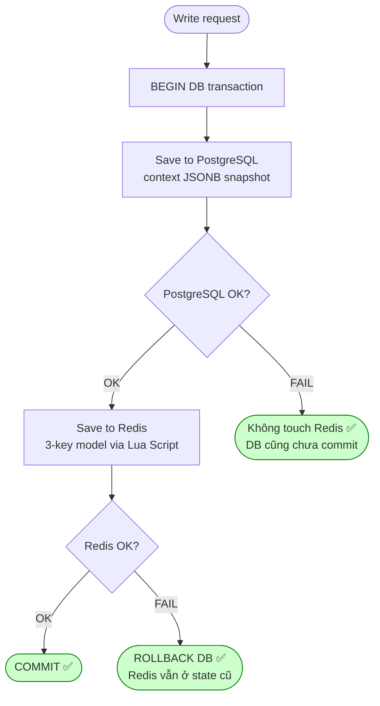

---

## 6. Cache-Aside Fallback

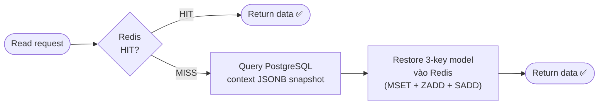

---

## 7. Saga Compensation — In-Game Purchase Flow

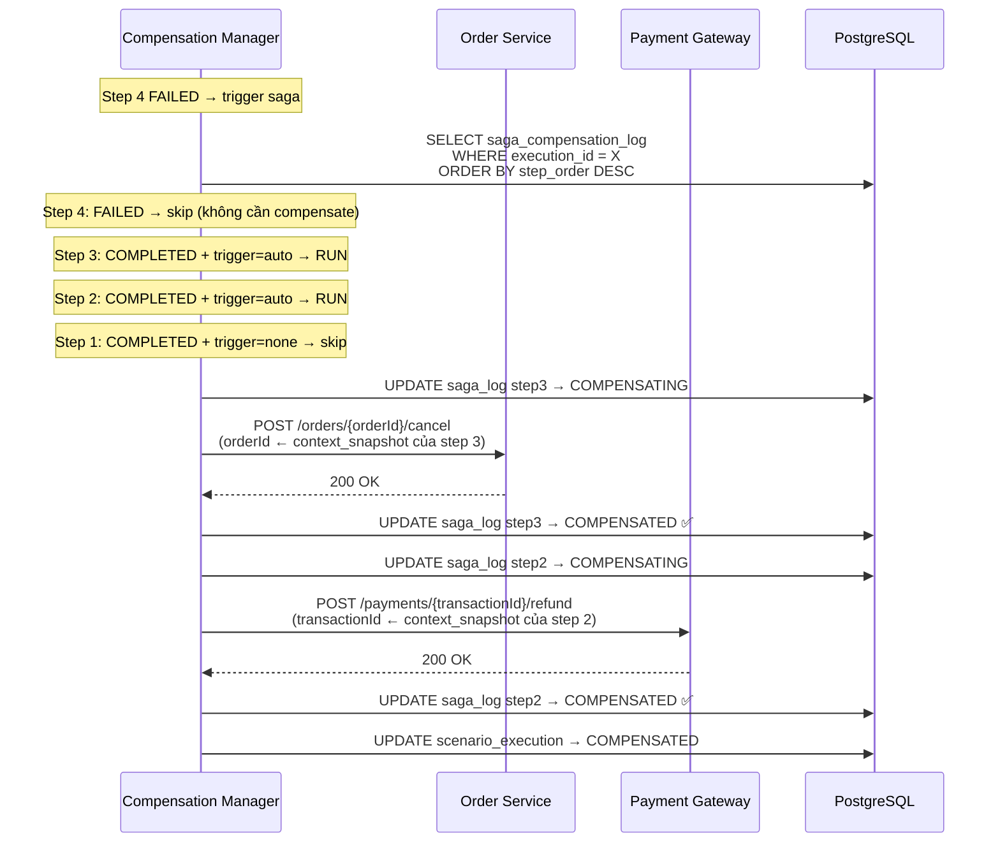

### Compensation Failure — Dead Letter

```mermaid
flowchart TD
    CF([refund_payment FAILS])
    DB1[UPDATE saga_log → COMPENSATION_FAILED]
    DL[INSERT compensation_dead_letter]
    ALERT[Alert admin\nSlack / email]
    API[Expose API:\nGET /executions/{id}/compensation-status\nPOST /executions/{id}/retry-compensation]

    CF --> DB1 --> DL & ALERT & API
```

---

## 8. CDC + Reconciliation — Ghost Transaction Flow

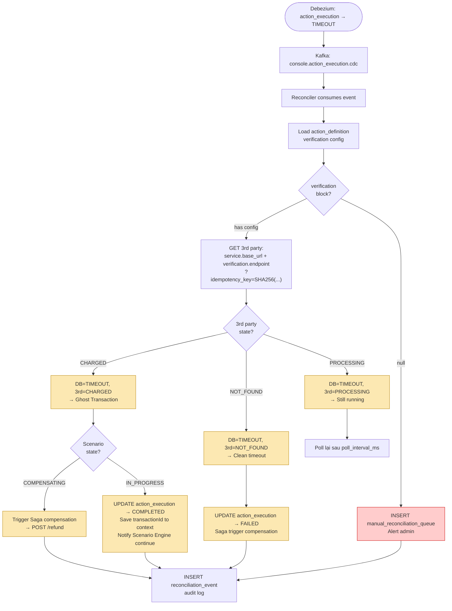

---

## 9. Reconciliation State Matrix

```mermaid
flowchart LR
    classDef ghost   fill:#ffcccc,stroke:#cc0000
    classDef clean   fill:#ccffcc,stroke:#007700
    classDef pending fill:#fff9c4,stroke:#f9a825
    classDef orphan  fill:#e8d5ff,stroke:#6a1b9a

    T1["DB=TIMEOUT\n3rd=CHARGED"]:::ghost     -->|"Ghost Transaction"| A1["Auto-compensate\nhoặc Auto-complete"]
    T2["DB=TIMEOUT\n3rd=NOT_FOUND"]:::clean   -->|"Clean timeout"| A2["Mark FAILED\n→ Saga"]
    T3["DB=TIMEOUT\n3rd=PROCESSING"]:::pending-->|"Still running"| A3["Poll lại sau interval"]
    T4["DB=FAILED\n3rd=CHARGED"]:::ghost      -->|"Ghost Txn (5xx)"| A4["Auto-compensate"]
    T5["DB=FAILED\n3rd=NOT_FOUND"]:::clean    -->|"Clean failure"| A5["No action\nSaga đã xử lý"]
    T6["DB=COMPLETED\n3rd=NOT_FOUND"]:::orphan-->|"Orphan record"| A6["Alert admin\nManual queue"]
    T7["DB=COMPLETED\n3rd=CHARGED"]:::clean   -->|"Consistent ✅"| A7["No action"]
    T8["DB=COMP_FAIL\n3rd=CHARGED"]:::ghost   -->|"Stale dead letter"| A8["Retry compensation"]
```

---

## 10. Resume Scenario (Cache-Aside Restore)

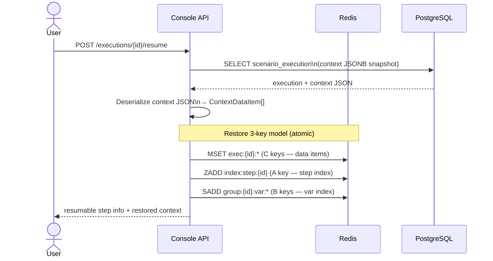

---

## 11. Access Control — 3 Tầng

```mermaid
flowchart TD
    REQ([User request])

    subgraph GW["Tầng 1 — GameScale Console Gateway"]
        T1{"Menu access\ncheck via RoleStore"}
    end

    subgraph RBAC["Tầng 2 — Console API RBAC"]
        T2{"sc:user:{userId}:exec\nin Redis?"}
        T2b[GET /rolestore/users/{userId}/permissions]
        T2c["Cache SET sc:user:{userId}:exec\nTTL 5 phút"]
        T2d{"scenario_id\nin allowed set?"}
    end

    subgraph ACTION["Tầng 3 — Per-Action Check"]
        T3{"execution\nownership check"}
    end

    DENY1([❌ 403 Redirect error])
    DENY2([❌ 403 Forbidden])
    DENY3([❌ 403 Forbidden])
    ALLOW([✅ Execute])

    REQ --> T1
    T1 -->|"denied"| DENY1
    T1 -->|"allowed"| T2
    T2 -->|"MISS"| T2b --> T2c --> T2d
    T2 -->|"HIT"| T2d
    T2d -->|"not in set"| DENY2
    T2d -->|"in set"| T3
    T3 -->|"not owner"| DENY3
    T3 -->|"owner"| ALLOW
```

---

## 12. Redis Key Namespaces — Toàn bộ System

```mermaid
mindmap
  root((Redis Keys))
    Execution Context
      exec:{execId}:{sourceType}:{srcId}:{varId}
        String - ContextDataItem JSON
        TTL: execution lifetime
      index:step:{execId}
        ZSET - score=stepOrder
        TTL: execution lifetime
      group:{execId}:var:{varId}
        Set - members=C keys
        TTL: execution lifetime
    Idempotency
      dedup:{execId}:{triggerId}:{requestId}
        String - "1"
        TTL: 60s
      result:{execId}:{triggerId}:{requestId}
        String - response JSON
        TTL: 300s
    RBAC
      sc:user:{userId}:exec
        Set - allowed scenario IDs
        TTL: 5 phút
```


## 13. Shopee / Shopee Ads — Mock-only Manual Preview

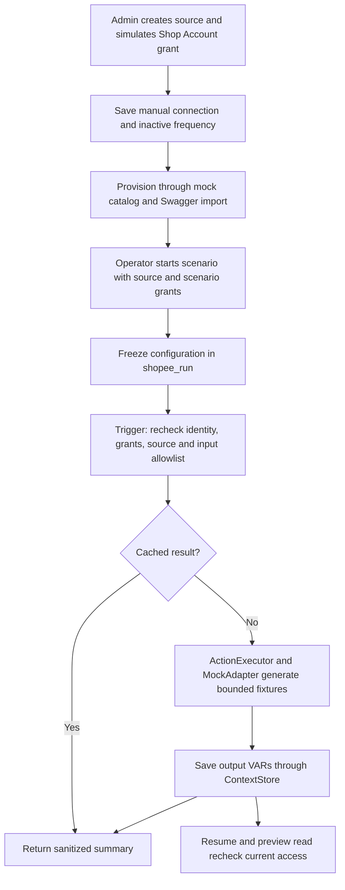

Live provider access and durable scheduled sync remain separately blocked/gated; see [integration guide](11-shopee-mock-integration.md).
