# Entity-Relationship Diagram — Scenario Console

> Generated from Flyway migrations (V1–V4) và JPA entities trong `common/src/main/java/com/simi/common/domain/entity/`

---

## Full ERD

```mermaid
erDiagram

    %% ─── DEFINITION LAYER (V1) ───────────────────────────────────────────────

    service {
        BIGSERIAL id PK
        VARCHAR name UK
        VARCHAR base_url
        TIMESTAMP created_at
        TIMESTAMP updated_at
    }

    retry_policy {
        BIGSERIAL id PK
        VARCHAR name UK
        INT max_attempts
        VARCHAR backoff_type "exponential | linear | fixed"
        INT initial_interval_ms
        INT max_interval_ms
        INT[] retryable_status_codes
        TIMESTAMP created_at
        TIMESTAMP updated_at
    }

    scenario_definition {
        BIGSERIAL id PK
        VARCHAR name
        TEXT description
        VARCHAR created_by
        TIMESTAMP created_at
        TIMESTAMP updated_at
    }

    step_definition {
        BIGSERIAL id PK
        BIGINT scenario_definition_id FK
        VARCHAR name
        INT step_order
        JSONB ui "widget layout + outputVarId"
        TIMESTAMP created_at
        TIMESTAMP updated_at
    }

    action_definition {
        BIGSERIAL id PK
        VARCHAR name
        BIGINT service_id FK
        VARCHAR endpoint
        VARCHAR http_method "GET|POST|PUT|PATCH|DELETE"
        VARCHAR adapter_type "http | async | mock"
        INT timeout_ms
        BIGINT retry_policy_id FK
        JSONB parameters "VAR_ULID array"
        JSONB output "VAR_ULID array"
        TIMESTAMP created_at
        TIMESTAMP updated_at
    }

    step_trigger {
        BIGSERIAL id PK
        BIGINT step_definition_id FK
        VARCHAR name
        VARCHAR trigger_type "button_click | on_load | on_change"
        VARCHAR widget_id
        TIMESTAMP created_at
        TIMESTAMP updated_at
    }

    step_trigger_action {
        BIGSERIAL id PK
        BIGINT step_trigger_id FK
        BIGINT action_definition_id FK
        INT action_order
        TIMESTAMP created_at
    }

    action_compensation {
        BIGSERIAL id PK
        BIGINT action_definition_id FK "UNIQUE"
        BIGINT compensation_action_definition_id FK
        VARCHAR trigger_type "auto | manual | none"
        TEXT[] required_var_ids "VAR_ULIDs cần nạp context"
        TIMESTAMP created_at
        TIMESTAMP updated_at
    }

    action_verification {
        BIGSERIAL id PK
        BIGINT action_definition_id FK "UNIQUE"
        VARCHAR endpoint
        VARCHAR http_method
        JSONB query_params
        JSONB conditions
        INT poll_interval_ms
        INT max_poll_attempts
        TIMESTAMP created_at
        TIMESTAMP updated_at
    }

    async_action_config {
        BIGSERIAL id PK
        BIGINT action_definition_id FK "UNIQUE"
        VARCHAR publish_to
        VARCHAR status_check_endpoint
        INT status_check_interval_ms
        INT status_check_timeout_ms
        VARCHAR done_condition
        TIMESTAMP created_at
    }

    %% ─── EXECUTION LAYER (V2) ────────────────────────────────────────────────

    scenario_execution {
        BIGSERIAL id PK
        BIGINT scenario_definition_id FK
        VARCHAR status "PENDING|EXECUTING|COMPLETED|FAILED|COMPENSATING|COMPENSATED|COMPENSATION_FAILED"
        INT current_step_order
        JSONB context "checkpoint snapshot"
        VARCHAR created_by
        TIMESTAMP created_at
        TIMESTAMP updated_at
    }

    trigger_execution {
        BIGSERIAL id PK
        BIGINT scenario_execution_id FK
        BIGINT step_trigger_id FK
        VARCHAR status "PENDING|RUNNING|COMPLETED|FAILED"
        VARCHAR request_id
        TIMESTAMP started_at
        TIMESTAMP completed_at
        TIMESTAMP created_at
        TIMESTAMP updated_at
    }

    action_execution {
        BIGSERIAL id PK
        BIGINT scenario_execution_id FK
        BIGINT trigger_execution_id FK "nullable — compensation actions"
        BIGINT action_definition_id FK
        VARCHAR status "PENDING|PROCESSING|COMPLETED|FAILED|TIMEOUT"
        VARCHAR idempotency_key UK "SHA256(execId+actDefId+sorted_params)"
        JSONB response_snapshot
        VARCHAR s3_ref "claim-check khi response gt 100KB"
        VARCHAR error_message
        TIMESTAMP started_at
        TIMESTAMP completed_at
        TIMESTAMP created_at
        TIMESTAMP updated_at
    }

    %% ─── SAGA LAYER (V3) ─────────────────────────────────────────────────────

    saga_compensation_log {
        BIGSERIAL id PK
        BIGINT scenario_execution_id FK
        BIGINT action_execution_id FK "nullable"
        BIGINT action_definition_id FK
        INT step_order "denorm cho ORDER BY DESC hot path"
        VARCHAR status "PENDING|COMPENSATING|COMPENSATED|COMPENSATION_FAILED"
        BIGINT compensation_action_execution_id FK "nullable"
        JSONB context_snapshot "variable values tại thời điểm chạy"
        TIMESTAMP created_at
        TIMESTAMP updated_at
    }

    compensation_dead_letter {
        BIGSERIAL id PK
        BIGINT saga_compensation_log_id FK
        BIGINT scenario_execution_id FK
        BIGINT action_definition_id FK
        JSONB context_snapshot
        TEXT failure_reason
        INT retry_count
        BOOLEAN resolved
        TIMESTAMP resolved_at
        TIMESTAMP created_at
    }

    %% ─── RECONCILIATION LAYER (V4) ───────────────────────────────────────────

    reconciliation_event {
        BIGSERIAL id PK
        BIGINT scenario_execution_id FK
        BIGINT action_execution_id FK
        VARCHAR drift_type "GHOST_TRANSACTION|ORPHAN_RECORD|LOST_RESPONSE|STALE_COMPENSATION"
        VARCHAR db_state
        VARCHAR third_party_state
        JSONB third_party_response
        VARCHAR resolution "AUTO_COMPENSATED|AUTO_COMPLETED|MANUAL_QUEUED|NO_ACTION"
        TIMESTAMP detected_at
        TIMESTAMP resolved_at
        TEXT notes
        TIMESTAMP created_at
    }

    %% ─── RELATIONSHIPS ───────────────────────────────────────────────────────

    %% Definition layer
    service                 ||--o{ action_definition          : "hosts"
    retry_policy            ||--o{ action_definition          : "retries-via"
    scenario_definition     ||--o{ step_definition            : "contains"
    step_definition         ||--o{ step_trigger               : "has"
    step_trigger            ||--o{ step_trigger_action        : "fires"
    action_definition       ||--o{ step_trigger_action        : "included-in"
    action_definition       ||--o| action_compensation        : "compensated-by"
    action_definition       ||--o| action_verification        : "verified-by"
    action_definition       ||--o| async_action_config        : "async-config"
    action_definition       ||--o{ action_compensation        : "is-comp-of"

    %% Execution layer
    scenario_definition     ||--o{ scenario_execution         : "instantiated-as"
    scenario_execution      ||--o{ trigger_execution          : "tracks"
    scenario_execution      ||--o{ action_execution           : "runs"
    step_trigger            ||--o{ trigger_execution          : "executed-as"
    trigger_execution       ||--o{ action_execution           : "produces"
    action_definition       ||--o{ action_execution           : "executed-as"

    %% Saga layer
    scenario_execution      ||--o{ saga_compensation_log      : "saga-log"
    action_execution        ||--o{ saga_compensation_log      : "logged-in"
    action_definition       ||--o{ saga_compensation_log      : "comp-def"
    action_execution        ||--o{ saga_compensation_log      : "comp-exec"
    saga_compensation_log   ||--o| compensation_dead_letter   : "dead-lettered"
    scenario_execution      ||--o{ compensation_dead_letter   : "dl-ref"
    action_definition       ||--o{ compensation_dead_letter   : "dl-def"

    %% Reconciliation layer
    scenario_execution      ||--o{ reconciliation_event       : "audited-in"
    action_execution        ||--o{ reconciliation_event       : "verified-in"
```



---

## Layers

| Layer | Tables | Migration | Mục đích |
|---|---|---|---|
| **Definition** | service, retry_policy, scenario_definition, step_definition, action_definition, step_trigger, step_trigger_action, action_compensation, action_verification, async_action_config | V1 | Template / cấu hình tĩnh |
| **Execution** | scenario_execution, trigger_execution, action_execution | V2 | Runtime state, idempotency tầng 3+4 |
| **Saga** | saga_compensation_log, compensation_dead_letter | V3 | Reverse-order compensation + dead letter |
| **Reconciliation** | reconciliation_event | V4 | CDC drift detection, audit |

---

## Key Constraints

| Table | Constraint | Ý nghĩa |
|---|---|---|
| `trigger_execution` | `UNIQUE (scenario_execution_id, step_trigger_id)` | **Tầng 3** idempotency |
| `action_execution` | `UNIQUE idempotency_key` (SHA256) | **Tầng 4** idempotency, chặn cross-session retry |
| `action_compensation` | `UNIQUE action_definition_id` | 1 action → 1 compensation definition |
| `action_verification` | `UNIQUE action_definition_id` | 1 action → 1 verification endpoint |
| `async_action_config` | `UNIQUE action_definition_id` | 1 action → 1 async config |
| `service` | `UNIQUE name` | Không trùng tên service |
| `retry_policy` | `UNIQUE name` | Không trùng tên policy |

---

## JSONB Fields

| Table | Column | Nội dung |
|---|---|---|
| `step_definition` | `ui` | Widget layout, outputVarId (VAR_ULID) |
| `action_definition` | `parameters` | Array `{varId, name, type, required}` |
| `action_definition` | `output` | Array `{varId, name, type}` |
| `action_execution` | `response_snapshot` | Raw response từ 3rd party (≤ 100KB) |
| `scenario_execution` | `context` | Checkpoint snapshot toàn bộ variable |
| `saga_compensation_log` | `context_snapshot` | Variable values tại thời điểm action chạy |
| `compensation_dead_letter` | `context_snapshot` | Copy từ saga log khi compensation thất bại |
| `action_verification` | `query_params` | Template params cho polling endpoint |
| `action_verification` | `conditions` | Điều kiện done/fail từ response JSON |
| `reconciliation_event` | `third_party_response` | Raw response khi reconciler poll |

---

## CDC Publication (V6)

Debezium logical replication `console_reconciliation_pub` bắt WAL trên 3 bảng hot:

```
action_execution  →  MSK  →  reconciliation-service
scenario_execution
saga_compensation_log
```
